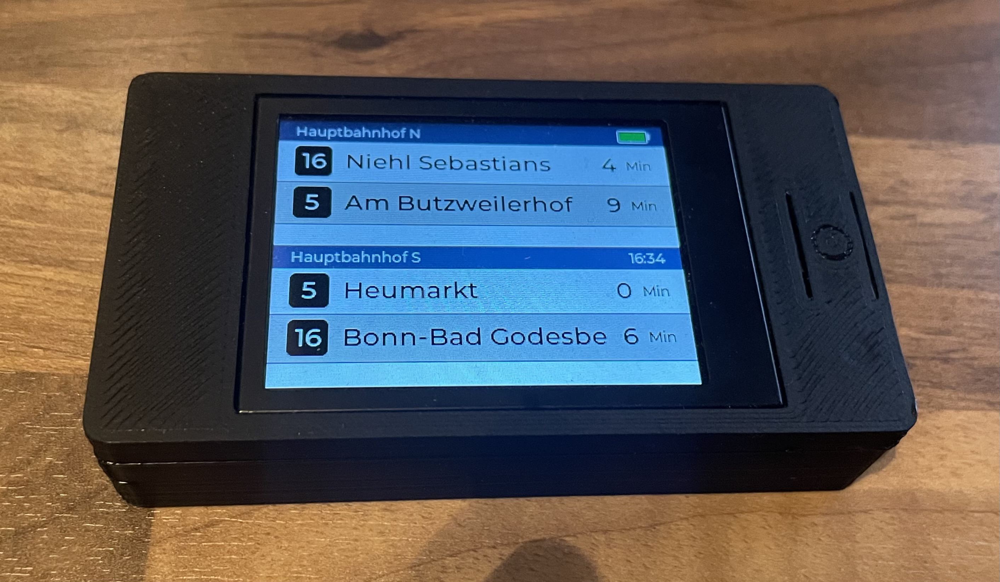
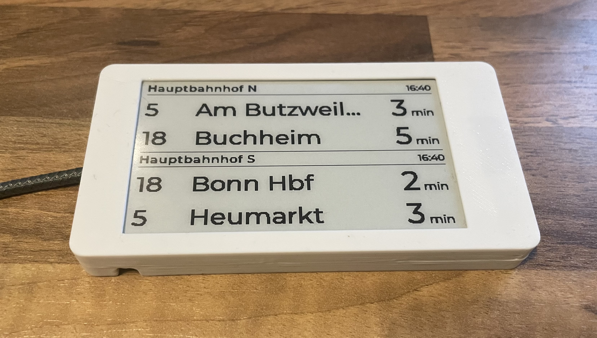
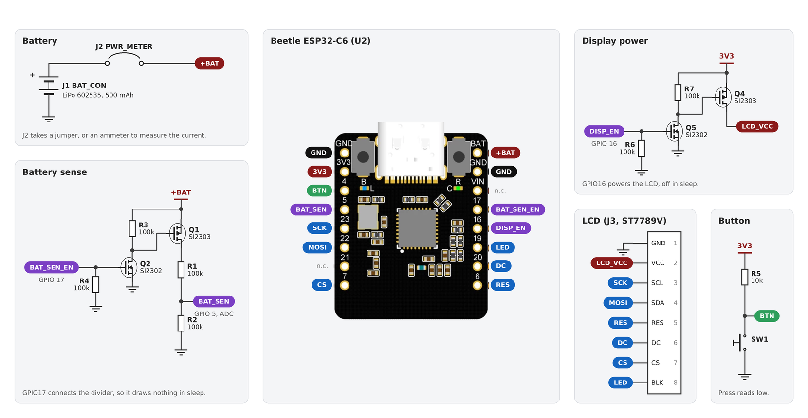
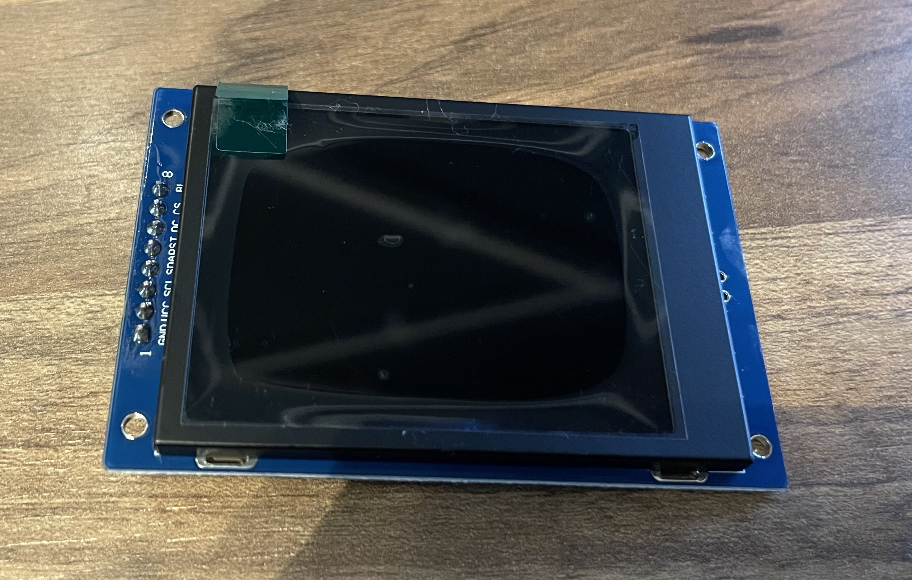
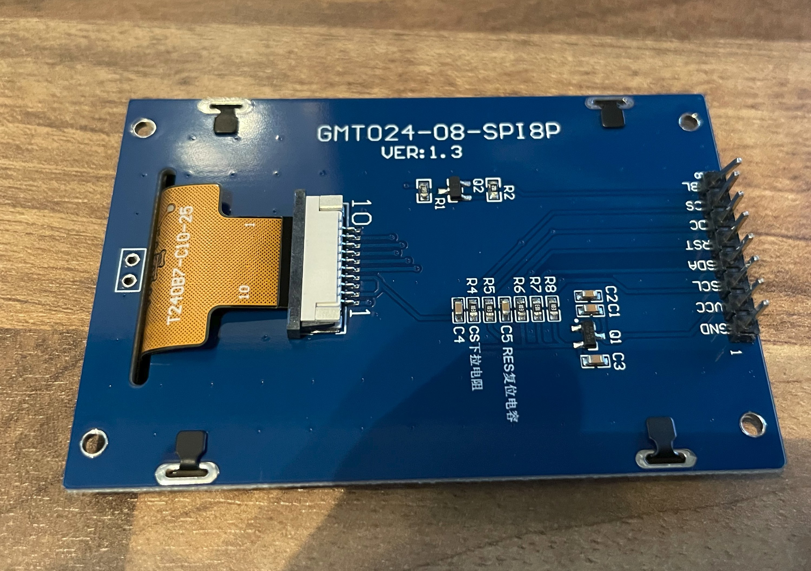
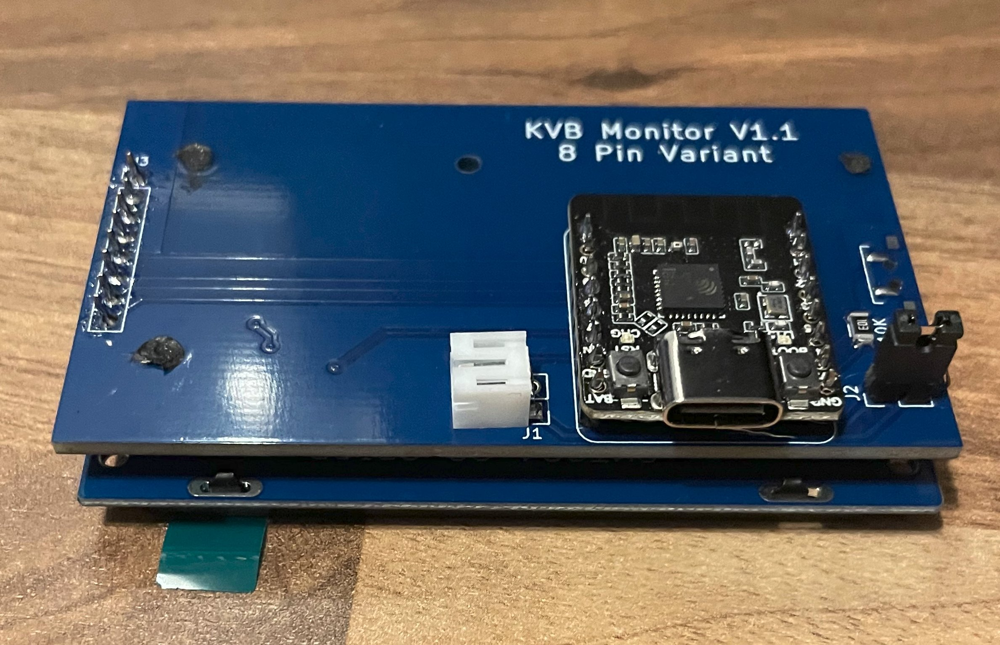
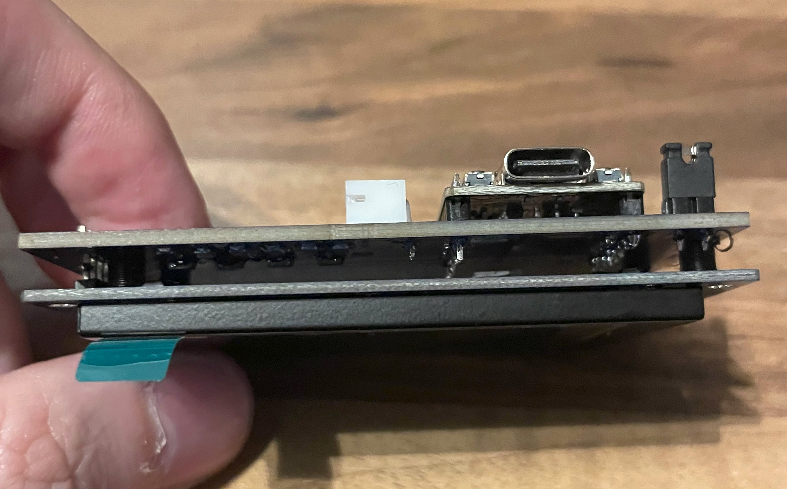
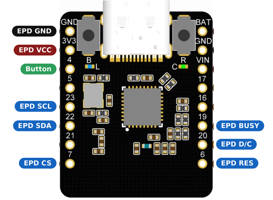

# Departure Board

This is a little project for a public transportation departure board.
It was mostly designed around the KVB/VRS API in Cologne but it also includes a
general parser for motis via transitous.org. Additional parsers/downloaders can
be added.

Because of display size it is limited to the next two departures on two
endpoints that can be configured.

For VRS the configuration is easy, just create your own monitor
[here](https://www.vrs.de/fahrplanauskunft/abfahrtsmonitor) and add the monitor
id to the device configuration.
For transitous there is a [helper site](tools/motis-stops.html) in the tools
folder that can create an API call for you to add to the device.

Planned are two variants, one cheap battery powered device with an LCD that
shows the current departures after a button press. With a 500 mAh battery it
should last about 3 months on one charge when used twice daily.

<p align="center">
  
</p>

The other variant is a more expensive E-Ink display version that is constantly
powered and holds the current departures. Intended as your own departure board
at home.

<p align="center">
  
</p>

## Configuration

To configure plug the device into an usb port on your computer.

The device has a configuration mode that can be entered by holding the device button for 3 seconds. A message will tell you when to stop holding.
The device will also enter configuration mode automatically if nothing is configured or it detects an incorrect configuration.

### Configuration entries
The device has 7 mandatory configuration entries. To set them either use a serial console or the helper website found [here](tools/device-config.html) (later hosted page).

- **WiFi SSID/Password** - The wifi credentials used to download the monitor information.
- **Station A/B Label** - The label shown the blue bar, to remind what is configured there.
- **Station A/B ID** - This is the part of the download string that identifies the station/track, it is appened to the base string. For VRS this is the monitor id e.g. `abcd1234abcd1234abcd1234abcd1234` for Motis it is something like `de-VBB_de:11000:900100003::3`. Because of memory limitations it is recommended to limit the VRS
number of departures to something like 4 to avoid out of memory issues.
- **Provider** - Selects which transporation provider the station id is used for 0 is VRS 1 is MOTIS.

There are several advanced configuration entries that dont need to be set.

- **Base Link** - Overrides the base link of the provider (basically the front of the string).
- **Brightness** - Sets the display brightness, 1 to 100 (default 50).
- **Display Time** - Sets how many seconds the departures stay on screen before the device goes back to sleep, 5 to 300 (default 30).
- **Refresh Time** - Sets how many seconds an always powered device (e.g. the e-ink board) waits between two refreshes of the board, 10 to 3600 (default 60). A button press refreshes right away. Does nothing on a battery device, which goes to sleep after every update instead.
- **Config Timeout** - Sets the Amount of time the device stays in the configuration mode before it shuts down automatically to save battery, 10 to 3600 seconds (default 300).
- **Certificate Check** - Checks that the server certificate comes from Let's Encrypt and is within its validity dates (1, default). Only switch it off (0) for a base link on a host that uses another certificate authority.

### How to use the configuration website
The configuration website is based on Webserial to access the plugged in device.
On connect it will show a list of devices, pick the one that is the monitor (if unsure unplug, press connect and cancel and then plug in and find the device that wasn't there before).

The device needs to be woken up to be able to connect to it! Press the button to do so.
When you are connected the easiest way is to press the config mode + reset button to get the device into config mode. The website will then automatically read the device configuration and prefill the form if something was set before.

Then enter the configuration entries and press send configuration to send all the changes at once (takes a few moments, progress is shown on top).

The new configuration will load on the next wakeup cycle. You can reset the device to see it work with the new changes from the website if you want.

## Error codes

When a wake cycle fails, the display shows the step that failed and a number.

### Connecting to Wifi

| Code | Meaning |
|---|---|
| -11 | The WiFi driver failed to start. Retry; if it persists it is a firmware or hardware fault, not a configuration one. |
| -22 | The request was rejected before the radio even tried: the password is shorter than 8 or longer than 64 characters, or the SSID is empty or longer than 32 characters. Fails instantly instead of after 30 seconds. |
| **-111** | The access point rejected three association attempts.|
| **-116** | No IP address within 30 seconds. The network is out of range, the SSID is misspelled so nothing answers. |

### Getting Data

| Code | Meaning |
|---|---|
| **-1** | The response has more JSON elements than the parser can hold. Ask for fewer departures. |
| **-2** | The host name does not exist, so the base link is misspelled. |
| **-3** | Temporary DNS failure, or the JSON arrived truncated. |
| -4 | The DNS server reported a failure for the lookup. Usually a router or network problem rather than a configuration one. |
| **-5** | The server answered with an HTTP error status, or closed the connection without answering at all. |
| -11 | No DNS server is configured, usually because the router handed none out. Fails instantly instead of after a timeout. |
| **-12** | The response is larger than the 16 KB buffer. Reduce the number of departures requested in the station ID. |
| **-77** | The JSON is valid but not the expected shape. The feed changed, or the provider setting does not match the kind of station ID configured. |
| -91 | The host name in the base link is longer than 63 characters, or the base link path together with the station ID is longer than 255 characters. |
| **-101** | The DNS lookup timed out. The most common failure on a freshly connected link. Usually succeeds on the next wakeup. |
| -104, -113, -128 | The connection was torn down in the middle of the transfer. |
| **-111** | The host resolved but refused the connection. A provider outage or a wrong base link. |
| -114, -118 | No route to the host, usually because the WiFi link dropped right after connecting. |
| **-116** | Timed out: no answer from the time server within two 5 second attempts, the connection to the provider could not be set up in time, or the provider did not answer the request within 5 seconds. |
| -134 | The configured provider number is neither 0 (VRS) nor 1 (MOTIS). |
| certificate | The server certificate failed the check: it is not from Let's Encrypt, does not match the host, or is expired or not yet valid. See Certificate Check above. |

## Hardware

The hardware is designed around a
[DFRobot Beetle ESP32C6 Module](https://wiki.dfrobot.com/dfr1117/) that is
cheaply available for around 5 Euros and includes an integrated antenna.

For the battery powered device I use a 2.4 inch LCD screen with a ST7789 controller.
And a 602535 500 mAh LiPo battery.
The software also runs two MOSFET circuits on a custom shield to power down the LCD and the battery
voltage divider on the shield during sleep.

<p align="center">
  
</p>

<p align="center">
  
  
</p>

<p align="center">
  
  
</p>

(Notes: The DFR1117 already includes a voltage divider on the board but the
readings seem off. Also shutting down the display via commands did not result
in the expected power savings. Thus the first version has its own display
rails that can be turned off and a external voltage divider. TODO: investigate).

The e-ink device uses the same module with a 3.7 inch 240 x 416 e-paper display with a UC8253
controller, powered over USB-C. It needs no shield, the display and the button are wired directly.
The button connects GPIO 4 to GND, with an external 10 kΩ pull-up from GPIO 4 to 3V3, so a press
reads as low.

<p align="center">
  
</p>

# Development

## Workspace Layout

This repository is the manifest repository of its own west workspace. After
setup, the workspace looks like this:

```
<workspace>/                 # west topdir
├── departure-board-zephyr/  # this repository
└── zephyrproject/           # Zephyr related stuff
    ├── .venv/
    ├── zephyr/
    └── modules/
```

## Getting Started

```sh
# Choose a workspace directory and a folder for Zephyr.
mkdir -p "workspace/zephyrproject"

# Create and activate a virtual environment for Zephyr
python3 -m venv "workspace/zephyrproject/.venv"
source "workspace/zephyrproject/.venv/bin/activate"

# Install west
pip install west

# Fetch this project and its dependencies
cd workspace
west init -m https://github.com/SebSal/departure-board-zephyr
west update

# Fetch the ESP32 HAL blobs
west blobs fetch hal_espressif
```

## Environment Setup

Run these in every new shell before building.

```sh
source ~/workspace/zephyrproject/.venv/bin/activate
source ~/workspace/zephyrproject/zephyr/zephyr-env.sh
```

## Debug

`debug.conf` raises the log levels of the config, shell and settings code to debug, and holds
the commented-out network and TLS ones. Layer it over `prj.conf`:

```sh
west build -d build -- -DEXTRA_CONF_FILE=debug.conf
```

The build directory remembers it, so a later plain `west build` keeps the debug levels until the
build is made pristine with `-p always`.

Build with debug thread info and the ESP32 OpenOCD paths:

```sh
west build -p always -- \
    -DCONFIG_DEBUG_THREAD_INFO=y \
    -DOPENOCD=~/openocd-esp32/bin/openocd \
    -DOPENOCD_DEFAULT_PATH=~/openocd-esp32/share/openocd/scripts
```

Then start the debug server:

```sh
west debugserver
```

## Case
The openscad files for the cases shown in the pictures can be found in the openscad folder.

## AI usage information
Both device-config.html and motis-stops.html as well as the openscad files are completly claude generated. I did not review the code but it seems to be doing what was intended. If you want to modify them it might make sense to just let claude modify it instead of working through whatever spagetti this is.
